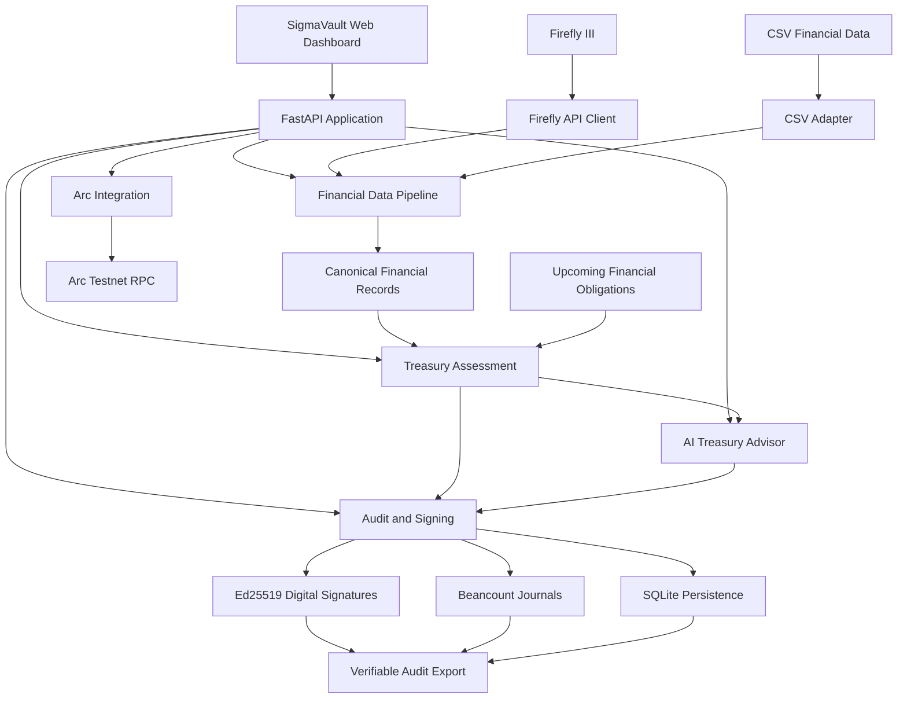

# SigmaVault

### AI-Assisted Treasury Intelligence with Verifiable Financial Auditing

**Make smarter treasury decisions. Protect operational liquidity. Verify every recorded decision.**

SigmaVault is an AI-assisted treasury management platform designed to help businesses understand their financial obligations, assess available liquidity, and make informed capital allocation decisions.

It combines financial data integration, deterministic liquidity analysis, AI-generated recommendations, blockchain wallet monitoring, and cryptographically signed accounting records into a unified treasury workflow.

Rather than allowing an AI agent to move money without oversight, SigmaVault emphasizes **financial safety, explainability, traceability, and human control**.

---

## The Problem

Many small and medium-sized businesses struggle to manage their working capital efficiently.

Financial information is often distributed across spreadsheets, accounting systems, bank statements, and disconnected financial applications.

This creates several challenges:

- Limited visibility into upcoming financial obligations.
- Difficulty determining how much cash is genuinely available.
- Risk of allocating money needed for essential business expenses.
- Manual and time-consuming treasury analysis.
- Poor traceability of financial decisions.
- Difficulty independently verifying automated financial recommendations.

Traditional financial dashboards primarily display historical information. Businesses also need systems that can reason about upcoming obligations, evaluate financial constraints, and explain recommended actions.

**SigmaVault addresses this gap by combining financial intelligence with verifiable accountability.**

---

## Our Solution

SigmaVault provides a treasury decision-support workflow that connects financial information to actionable liquidity intelligence.

The system is designed around six capabilities:

1. **Financial Data Integration** — Retrieve and normalize financial records from accounting sources.
2. **Liquidity Assessment** — Evaluate available cash against operational requirements.
3. **Financial Obligation Analysis** — Track upcoming bills and identify potential liquidity pressure.
4. **AI Treasury Recommendations** — Generate explainable, context-aware treasury guidance.
5. **Blockchain Integration** — Observe Arc Testnet wallet state and support blockchain-oriented treasury workflows.
6. **Cryptographically Verifiable Auditing** — Preserve signed financial decision records using Beancount and Ed25519 signatures.

These components help businesses understand not only what action might be beneficial, but also why that action is appropriate and what financial constraints must be respected.

---

## Core Features

### 1. AI-Powered Treasury Advisor

SigmaVault incorporates an AI-assisted decision layer that evaluates treasury information and produces human-readable recommendations.

The advisor considers financial context such as:

- Available operational cash.
- Minimum liquidity reserves.
- Upcoming financial obligations.
- Planning horizons.
- Financial constraints and liquidity risks.

Its purpose is to support decisions such as whether available liquidity should be preserved, reviewed, or considered for further capital allocation.

**Key principle:** AI-generated recommendations are advisory. They do not independently authorize financial transactions.

This separation helps prevent uncertain model outputs from becoming unrestricted financial execution instructions.

### 2. Deterministic Liquidity Safeguards

Financial calculations should not depend solely on language-model reasoning.

SigmaVault uses deterministic Python-based financial logic to evaluate operational liquidity.

The liquidity assessment considers:

- Available cash.
- Required minimum buffer.
- Upcoming bills.
- Planning horizon.
- Financial obligations and their status.

Conceptually:

```text
Available Cash
    |
    v
Subtract Minimum Operational Buffer
    |
    v
Account for Upcoming Financial Obligations
    |
    v
Evaluate Remaining Liquidity
    |
    v
Generate Treasury Assessment
```

This design separates mathematical financial safeguards from the AI layer responsible for interpreting and explaining results.

### 3. Firefly III Financial Integration

SigmaVault integrates with Firefly III, an open-source personal finance management system, to retrieve financial transaction information.

The integration includes:

- Authenticated API communication.
- Account transaction retrieval.
- Pagination handling.
- Financial record normalization.
- Transaction categorization and interpretation.
- Support for downstream treasury analysis.

The integration is organized around a dedicated API client and source adapter.

```text
Firefly III
    |
    v
Firefly API Client
    |
    v
Firefly Source Adapter
    |
    v
Canonical Financial Records
    |
    v
Treasury Analysis
```

By separating external API communication from internal financial logic, SigmaVault can be extended to additional financial data providers.

**Data integrity note:** Records retrieved from Firefly III represent information maintained in that accounting system. They are not automatically proof of independent bank settlement.

### 4. Upcoming Financial Obligations

SigmaVault supports the management and analysis of upcoming business expenses.

Users can record obligations with information such as:

- Bill identifier.
- Description.
- Amount.
- Due date.
- Payment status.

These obligations provide context for liquidity assessment.

For example, a business may appear to have surplus cash today but still face significant financial obligations within the next 30 days.

SigmaVault helps identify that distinction before recommending treasury actions.

### 5. Arc Testnet Wallet Observation

SigmaVault includes an integration with Arc Testnet for blockchain-oriented treasury workflows.

The wallet observation component is designed to retrieve:

- Blockchain network.
- Chain ID.
- Current observed block.
- Wallet address state.
- Native USDC balance.
- Observation timestamp.

The integration separates blockchain observation from financial execution authority.

**Important:** A successfully observed wallet balance does not mean funds have been transferred, invested, or authorized for spending.

Blockchain transaction execution and settlement must be independently demonstrated and verified.

### 6. Cryptographically Signed Treasury Audit Trail

One of SigmaVault's central differentiators is its focus on verifiable financial decision records.

Treasury decisions can be recorded using:

- Structured decision payloads.
- Human-readable explanations.
- Ed25519 digital signatures.
- Beancount accounting journals.
- Cryptographic hashes.
- Persistent financial record storage.

This provides a foundation for verifying whether recorded financial information has been modified.

The audit architecture separates several concepts:

**Financial decision:** What the treasury system recommended.

**Explanation:** Why the recommendation was made.

**Accounting record:** How a qualifying financial event is represented in a double-entry ledger.

**Digital signature:** Cryptographic evidence supporting the integrity and authenticity of a signed record.

**Execution evidence:** Separate evidence required to establish that a financial transaction actually occurred.

This separation is essential for trustworthy financial automation.

### 7. Downloadable Audit Package

SigmaVault provides an audit export workflow that packages financial and decision records for independent review.

The export architecture includes:

```text
sigmavault_ledger.beancount
treasury_decisions.beancount
signed_decisions.json
signed_financial_transactions.json
public_key.pem
manifest.json
```

The package is designed to support:

- Human review.
- Financial record inspection.
- Signature verification.
- Audit traceability.
- Independent validation of recorded decisions.

By using Beancount, SigmaVault keeps accounting records in a structured, readable format rather than relying exclusively on an opaque application database.

### 8. Shared Tester Authentication

SigmaVault includes a lightweight authentication foundation for controlled pilot access.

The implementation uses:

- Argon2 password hashing.
- Cryptographically random session tokens.
- SHA-256 session token hashes.
- SQLite-backed session persistence.
- Session expiration.
- Session revocation.

The pilot authentication model is designed around a shared tester account.

For production deployment, authentication must also be enforced consistently across protected endpoints, with appropriate HTTPS, secure cookies, login throttling, and CSRF protections.

---

## System Architecture

SigmaVault follows a modular architecture that separates external integrations, financial calculations, AI reasoning, blockchain interactions, and auditing.



### Architectural Principles

**Separation of concerns**

Each subsystem has a clearly defined responsibility.

**Deterministic financial safeguards**

Financial constraints are evaluated using explicit mathematical logic.

**AI as a decision-support component**

The AI layer explains and interprets treasury information rather than independently authorizing transactions.

**Integration isolation**

External systems are accessed through dedicated clients and adapters.

**Cryptographic accountability**

Signed records provide evidence that can be independently verified.

**Testability**

Core financial logic, integration boundaries, and audit operations can be tested independently.

---

## Technology Stack

| Layer | Technology |
|---|---|
| Primary language | Python 3.12+ |
| Backend API | FastAPI |
| Data validation | Pydantic |
| AI orchestration | Pydantic AI |
| HTTP integrations | HTTPX |
| Blockchain integration | Web3.py |
| Blockchain network | Arc Testnet |
| Financial data provider | Firefly III |
| Accounting journal | Beancount |
| Cryptographic signatures | Ed25519 |
| Persistent local storage | SQLite |
| Password hashing | Argon2 / pwdlib |
| Frontend | HTML, CSS, JavaScript |
| Testing | Pytest |
| Dependency management | uv |
| Deployment target | Render |

---

## Project Structure

The main application is organized under the `sigmavault` Python package.

```text
SigmaVault/
├── src/
│   └── sigmavault/
│       ├── integrations/
│       │   ├── arc/
│       │   └── firefly/
│       │
│       ├── pipeline/
│       │   ├── csv_adapter.py
│       │   ├── firefly_adapter.py
│       │   └── coordinator.py
│       │
│       ├── treasury/
│       │   ├── agent_runner.py
│       │   ├── audit_export.py
│       │   ├── audit_key_config.py
│       │   ├── beancount_audit_journal.py
│       │   ├── combined_ledger.py
│       │   ├── decision_service.py
│       │   ├── forecast_workflow.py
│       │   └── ...
│       │
│       └── web/
│           ├── app.py
│           ├── auth.py
│           └── static/
│               └── index.html
│
├── tests/
├── data/
├── pyproject.toml
├── uv.lock
└── README.md
```

---

## Getting Started

### Prerequisites

You will need:

- Python 3.12 or newer.
- Git.
- uv package manager.
- Access to any external integrations you want to test.

### 1. Clone the Repository

```bash
git clone <YOUR_REPOSITORY_URL>
cd SigmaVault
```

### 2. Install Dependencies

```bash
uv sync
```

### 3. Configure Environment Variables

SigmaVault uses environment variables for integration credentials, signing configuration, and persistence paths.

Example configuration:

```bash
export SIGMAVAULT_DATABASE_PATH="data/sigmavault_pilot.sqlite3"

export SIGMAVAULT_AUDIT_JOURNAL_PATH="data/treasury_decisions.beancount"

export SIGMAVAULT_AUDIT_PRIVATE_KEY_PEM="<EXISTING_ED25519_PRIVATE_KEY_PEM>"

export SIGMAVAULT_TESTER_PASSWORD_HASH="<ARGON2_PASSWORD_HASH>"

export SIGMAVAULT_COOKIE_SECURE="false"

export FIREFLY_BASE_URL="<FIREFLY_INSTANCE_URL>"

export FIREFLY_ACCOUNT_ID="<FIREFLY_ACCOUNT_ID>"

export FIREFLY_TOKEN="<FIREFLY_API_TOKEN>"

export ARC_RPC_URL="https://rpc.testnet.arc.network"

export ARC_WALLET_ADDRESS="<PUBLIC_WALLET_ADDRESS>"
```

Configure only the integrations needed for your local test.

Never commit private keys, passwords, access tokens, or sensitive financial datasets.

For an HTTPS deployment, configure secure cookies and persistent storage.

### 4. Start the Application

```bash
uv run uvicorn sigmavault.web.app:app \
  --reload \
  --host 127.0.0.1 \
  --port 8003
```

Open:

```text
http://127.0.0.1:8003
```

### 5. Verify Application Health

```bash
curl http://127.0.0.1:8003/health
```

A successful response indicates that the FastAPI application is reachable.

---

## API Overview

SigmaVault exposes API endpoints for financial analysis, integration access, and auditing.

| Endpoint | Method | Purpose |
|---|---|---|
| `/health` | GET | Application health |
| `/api/assess` | POST | Treasury liquidity assessment |
| `/api/bills` | GET | Retrieve upcoming bills |
| `/api/bills` | POST | Create a financial obligation |
| `/api/bills/{bill_id}` | DELETE | Remove an obligation |
| `/api/agent/recommend` | POST | Generate an AI-assisted treasury recommendation |
| `/api/firefly/transactions` | GET | Retrieve normalized Firefly transactions |
| `/api/arc/wallet` | GET | Observe Arc Testnet wallet state |
| `/api/csv/preview` | POST | Validate and preview CSV financial data |
| `/api/csv/assess` | POST | Assess CSV financial data |
| `/api/audit/download` | GET | Download signed audit records |

Authentication routes under `/api/auth/` are part of the tester access integration.

Endpoint availability depends on the application configuration and deployment version.

---

## Testing and Verification

SigmaVault uses automated tests to validate financial calculations, integration behavior, and audit integrity.

Run the complete test suite:

```bash
uv run pytest -q
```

Run authentication tests:

```bash
uv run pytest tests/web/test_auth.py -v
```

Run CSV API tests:

```bash
uv run pytest tests/web/test_csv_preview.py -v
```

The test architecture emphasizes:

- Valid financial inputs.
- Invalid and malformed data.
- Financial boundary conditions.
- External integration failures.
- Record normalization.
- Cryptographic verification.
- Audit consistency.
- Session expiration and revocation.
- Financial execution safeguards.

A successful test suite does not substitute for a real end-to-end deployment test or independently verified blockchain transaction evidence.

---

## Hackathon Demonstration

The recommended SigmaVault demonstration illustrates the complete treasury decision-support workflow.

### Step 1 — Open the Treasury Dashboard

Introduce the SigmaVault interface and explain the business problem.

### Step 2 — Review Financial Information

Demonstrate financial records and upcoming obligations using configured data sources.

### Step 3 — Assess Operational Liquidity

Enter or retrieve treasury parameters and evaluate available cash against the minimum operational buffer.

### Step 4 — Generate an AI Treasury Recommendation

Demonstrate how SigmaVault converts financial information into an explainable recommendation.

Emphasize that financial constraints are enforced separately from AI-generated explanations.

### Step 5 — Observe the Arc Wallet

Where the Arc Testnet integration is configured, demonstrate blockchain network information and wallet balance observation.

Clearly distinguish blockchain observation from transaction execution.

### Step 6 — Download the Audit Package

Export the signed Beancount and JSON records.

Explain how the audit package supports human review and independent cryptographic verification.

### Step 7 — Demonstrate Financial Safety

Show that recommendations do not automatically authorize fund transfers and that treasury safeguards remain explicit.

**The central demonstration message: SigmaVault connects financial intelligence with verifiable accountability.**

---

## What Makes SigmaVault Different?

### Financial Intelligence with Mathematical Safeguards

SigmaVault combines AI-generated guidance with deterministic financial assessment.

The language model does not replace explicit liquidity constraints.

### Human-Readable, Cryptographically Verifiable Records

Rather than storing only opaque logs, SigmaVault uses structured accounting records and digital signatures.

### Blockchain-Aware Treasury Architecture

Arc Testnet integration creates a foundation for blockchain-oriented treasury workflows while maintaining clear distinctions between observation, authorization, execution, and settlement.

### Modular Financial Data Integration

Dedicated adapters separate external financial systems from internal business logic.

### Designed for Real Business Workflows

SigmaVault focuses on practical treasury questions involving cash availability, upcoming obligations, liquidity reserves, and financial accountability.

### Built with Verification in Mind

The architecture supports automated testing, signed records, and independently inspectable audit artifacts.

---

## Security and Financial Integrity

SigmaVault is designed around several security principles.

**Credential protection:** External API credentials and signing keys are supplied through server-side configuration.

**Cryptographic integrity:** Ed25519 signatures support verification of signed audit records.

**Financial safety:** Recommendations are distinct from transaction authorization.

**Record provenance:** Financial information retains source context.

**Session security:** Tester authentication uses hashed credentials and expiring sessions.

**Auditability:** Financial decision explanations and accounting records are designed to remain accessible for human inspection.

For public deployment, production-grade authentication enforcement, HTTPS, persistent storage, access controls, rate limiting, and appropriate operational monitoring are required.

---

## Deployment

SigmaVault can be deployed as a Python web service on Render.

Example build command:

```bash
pip install uv && uv sync --no-dev --locked
```

Example start command:

```bash
uv run --no-sync uvicorn sigmavault.web.app:app \
  --host 0.0.0.0 \
  --port $PORT
```

For deployments using SQLite and Beancount journals, persistent storage is essential.

Application restarts must not erase the financial records or signing material required for independent audit verification.

Sensitive credentials should be configured through the hosting provider's secret-management facilities.

---

## Current Scope and Future Development

SigmaVault's architecture provides a foundation for broader autonomous treasury capabilities.

Potential future development includes:

- Expanded bank and accounting integrations.
- Automated recurring-bill forecasting.
- Advanced liquidity and cash-flow analytics.
- Multi-user authentication and role-based access.
- Multi-account treasury management.
- Transaction authorization workflows.
- Verified onchain settlement and reconciliation.
- Production-grade monitoring and alerting.
- Stronger disaster recovery and audit retention.
- Additional financial reporting and visualization.

These capabilities should be treated as roadmap items unless independently demonstrated in the deployed version.

---

## Responsible AI and Financial Automation

SigmaVault follows a fundamental principle:

**AI should help businesses make better financial decisions without silently taking control of their money.**

The platform distinguishes between:

1. Financial observations.
2. Mathematical assessments.
3. AI-generated recommendations.
4. Human authorization.
5. Financial execution.
6. Independently verifiable settlement and audit evidence.

These stages should not be conflated.

This approach is intended to make financial automation more understandable, accountable, and trustworthy.

---

## Project Vision

Our vision is to build treasury systems that are not only intelligent, but also mathematically disciplined, transparent, and verifiable.

SigmaVault explores how artificial intelligence, traditional accounting principles, cryptographic signatures, and blockchain infrastructure can work together to support safer financial operations.

**Intelligent decisions. Protected liquidity. Verifiable accountability.**

---

*SigmaVault — AI-Assisted Treasury Intelligence and Verifiable Financial Auditing.*